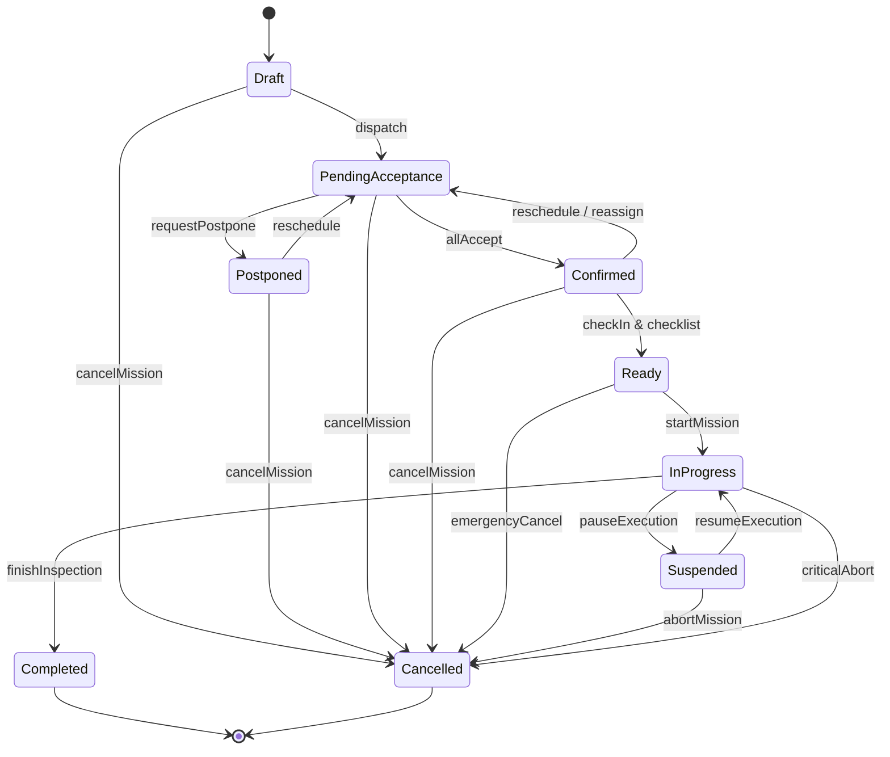
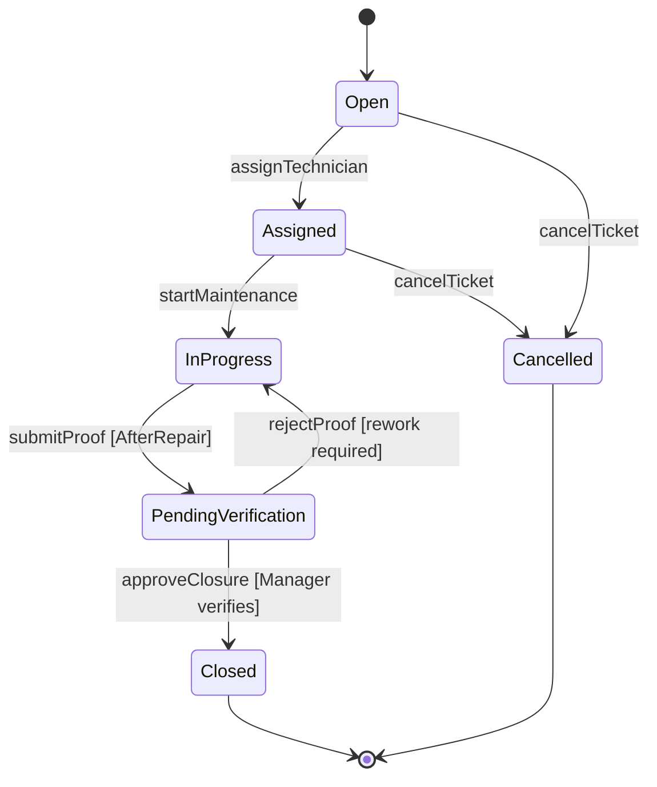

> [!WARNING] LEGACY / DEPRECATED — KHÔNG dùng làm nguồn đặc tả cho AI Agent.
> Bản nháp chức năng đời đầu trước v2.0. Nguồn sự thật duy nhất hiện hành là [`docs/MASTER_SYSTEM_SPEC.md`](docs/MASTER_SYSTEM_SPEC.md) (v2.0) và [`.specify/memory/constitution.md`](.specify/memory/constitution.md).

# UAV-PMS — Tài liệu Đặc tả Chức năng & Luồng Nghiệp vụ Dự án (Bản duyệt nhóm)

> **Mục đích**: Mô tả đầy đủ và thống nhất **hệ thống UAV-PMS làm gì, gồm những ai dùng, chạy qua những luồng nào và tuân thủ những quy tắc nghiệp vụ nào** để cả nhóm rà soát, phê duyệt (Approve) và làm cơ sở viết bộ tài liệu chính thức (SRS, Use Case, ERD, Báo cáo đồ án).

---

## 1. Tổng quan Dự án

**UAV Powerline Monitoring System (UAV-PMS)** là hệ thống quản lý và giám sát kiểm tra đường dây điện lực bằng thiết bị bay không người lái (UAV/Drone), hỗ trợ phát hiện khuyết tật bằng AI và điều phối bảo trì theo khu vực địa lý.

Hệ thống giải quyết trọn vòng đời vận hành từ khâu chuẩn bị an toàn bay → điều phối bay & giám sát vị trí UAV thời gian thực → phân tích hình ảnh bằng AI → thẩm định khuyết tật → lập và nghiệm thu phiếu bảo trì → tổng hợp báo cáo.

---

## 2. Phạm vi Dự án (Chốt phần Làm vs. Phần Không làm)

### ✅ Các phân hệ TRONG phạm vi dự án
- [ ] **Quản lý Tài khoản, Phân quyền (Multi-Role) & Phân vùng địa lý** (có xác thực OTP qua email thật).
- [ ] **Quản lý Tài sản Lưới điện & Thiết bị bay** (Khu vực, Cột điện, UAV/Drone, Bộ điều khiển bay).
- [ ] **Đánh giá An toàn Tiền nhiệm vụ (`Pre-Mission Assessment`)** — điều kiện bắt buộc trước khi bay.
- [ ] **Quản lý Nhiệm vụ bay (`Mission`)** kèm **Bản đồ nội bộ (`Local-only GIS`)** và **giám sát Telemetry thời gian thực** từ phần cứng thật qua Mission Planner.
- [ ] **Phân tích Ảnh/Video bằng AI & Thẩm định Khuyết tật** (tách riêng luồng vận hành từ Mission và luồng Test độc lập).
- [ ] **Quản lý Phiếu Bảo trì (`Maintenance Ticket`)**, ghi nhận vật tư & nghiệm thu minh chứng.
- [ ] **Báo cáo tổng hợp (`Reports`)**, **Nhật ký kiểm toán (`Audit Logs`)**, **Cấu hình hệ thống (`System Settings`)** và **Thông báo nhắc hạn tự động**.

### ❌ Các phân hệ NGOÀI phạm vi (Loại bỏ khỏi tài liệu & hệ thống)
- [ ] **Không có phân hệ Cảnh báo khẩn cấp (`Emergency Alert`) & Thiết bị Edge riêng**: Tính chất khẩn cấp chỉ là mức độ ưu tiên (`Khẩn cấp` / `Bình thường`) gắn trên khuyết tật và phiếu bảo trì.
- [ ] **Không có bước Bàn giao / Trả Drone thủ công**: Khi nhiệm vụ bay kết thúc hoặc bị hủy, hệ thống tự động giải phóng Drone.
- [ ] **Không có phân hệ Lịch kiểm tra định kỳ (`Inspection Schedules`)**.
- [ ] **Chưa triển khai luồng Active Learning** (sửa khung nhãn gửi huấn luyện lại AI — ghi nhận là hướng phát triển tương lai).

---

## 3. Các Vai trò (Actors) & Ma trận Phân quyền

Hệ thống có **5 vai trò chuẩn**, hỗ trợ **1 tài khoản có nhiều vai trò cùng lúc (Multi-Role)** — quyền thực tế là tổng hợp các vai trò mà tài khoản đang giữ:

1. **`SystemAdmin`** — Quản trị hệ thống: quản lý tài khoản, gán vai trò, **khóa phạm vi vùng địa lý hoạt động cho các vai trò khác**, xem nhật ký kiểm toán và cấu hình hệ thống.
2. **`Manager`** — Quản lý vận hành: quản lý tài sản trong vùng được phân công, duyệt đánh giá tiền nhiệm vụ, tạo/điều phối nhiệm vụ bay, giao và nghiệm thu phiếu bảo trì, xem kết quả tổng hợp & báo cáo.
3. **`Inspector`** — Nhân sự kiểm tra hiện trường: thực hiện kiểm tra tiền nhiệm vụ, nhận nhiệm vụ bay, check-in hiện trường, vận hành bay và nộp ảnh/video lên hệ thống.
4. **`Analyst`** — Chuyên viên thẩm định AI: **vai trò duy nhất** được xem chi tiết khung phát hiện lỗi (bounding box) của AI và quyết định xác nhận (`Approve`) hoặc từ chối (`Reject`) khuyết tật.
5. **`Technician`** — Kỹ thuật viên bảo trì: tiếp nhận phiếu bảo trì được giao, thực hiện sửa chữa, ghi nhận vật tư và nộp ảnh minh chứng hoàn thành.

| Nhóm chức năng | SystemAdmin | Manager | Inspector | Analyst | Technician |
|---|:---:|:---:|:---:|:---:|:---:|
| Quản lý User, Gán Multi-Role, **Khóa vùng địa lý**, Audit, Cấu hình | ✅ | ❌ | ❌ | ❌ | ❌ |
| Quản lý Khu vực, Cột điện, Drone, Bộ điều khiển bay | ✅ | ✅ *(theo vùng)* | Xem *(theo vùng)* | ❌ | Xem *(theo vùng)* |
| Đánh giá Tiền nhiệm vụ (`Pre-Mission`) | ✅ | ✅ *(theo vùng)* | Thực hiện | ❌ | ❌ |
| Tạo / Sửa / Hủy / Điều phối Nhiệm vụ bay (`Mission`) | ✅ | ✅ *(theo vùng)* | Nhận & thực hiện | ❌ | ❌ |
| Xem vị trí & thông số Telemetry UAV thời gian thực | ✅ | ✅ *(theo vùng)* | ✅ *(nhiệm vụ được giao)* | ❌ | ❌ |
| Nộp ảnh / video từ Mission lên AI | Chỉ nhận TB | Chỉ nhận TB | ✅ *(chỉ nhận TB Thành công/Thất bại)* | ✅ | ❌ |
| **Xem chi tiết kết quả AI (bbox) & Duyệt (`Approve`/`Reject`)** | ❌ *(trừ khi có role `Analyst`)* | ❌ *(trừ khi có role `Analyst`)* | ❌ *(trừ khi có role `Analyst`)* | **✅ (Duy nhất)** | ❌ |
| Dùng chế độ Upload Test AI độc lập (xem kết quả test của chính mình) | ❌ | ❌ | ❌ | **✅ (Duy nhất)** | ❌ |
| Xem kết quả tổng hợp & Xuất Báo cáo (`Reports`) | ✅ | ✅ *(theo vùng)* | ❌ | ✅ *(theo vùng)* | Xem danh sách |
| Giao & Nghiệm thu đóng Phiếu Bảo trì | ✅ | ✅ *(theo vùng)* | ❌ | ❌ | ❌ |
| Thực hiện Bảo trì, khai báo vật tư & nộp minh chứng | ❌ | ❌ | ❌ | ❌ | ✅ *(phiếu được giao)* |

> **Quy tắc phân vùng địa lý**: Chỉ `SystemAdmin` có quyền gán/khóa vùng địa lý cho các vai trò khác. Ngoại trừ `SystemAdmin`, mọi nhân sự chỉ được xem và thao tác dữ liệu (Cột điện, Nhiệm vụ, Khuyết tật, Phiếu bảo trì, Báo cáo) thuộc đúng khu vực mình được phân công.

---

## 4. Chi tiết 5 Luồng Nghiệp vụ Chính

### Luồng 1 — Quản lý Tài khoản, Đăng nhập & Xác thực OTP
- [ ] `SystemAdmin` tạo tài khoản mới, bắt buộc chọn ít nhất 1 vai trò hợp lệ (hệ thống không tự gán quyền mặc định) và gán vùng địa lý hoạt động.
- [ ] Hệ thống gửi **mã OTP thật qua email** để xác thực tài khoản mới.
- [ ] Khi người dùng đăng nhập từ **thiết bị mới** hoặc thiết bị chưa được đánh dấu tin cậy → hệ thống gửi **mã OTP thật qua email**; chỉ cấp phiên làm việc sau khi nhập đúng OTP.
- [ ] Khi đổi mật khẩu (bắt buộc xác thực mật khẩu cũ hoặc OTP), reset mật khẩu hoặc khóa tài khoản → hệ thống thu hồi toàn bộ phiên đăng nhập và thiết bị tin cậy cũ.

### Luồng 2 — Quản lý Tài sản & Đánh giá Tiền nhiệm vụ (`Pre-Mission`)
- [ ] `Manager` / `SystemAdmin` quản lý danh mục Khu vực, Cột điện (tọa độ trên bản đồ), UAV/Drone và Bộ điều khiển bay.
- [ ] Trước khi lập nhiệm vụ bay, đội vận hành phải lập **Bản đánh giá Tiền nhiệm vụ** kiểm tra: khu vực/cột cần bay, nhân sự tham gia, tình trạng kỹ thuật Drone và điều kiện an toàn.
- [ ] **Điều kiện hiệu lực**: Bản đánh giá đạt chuẩn có thời hạn hiệu lực **tối đa không quá 7 ngày** và **bắt buộc phải còn hiệu lực tại cả thời điểm tạo Nhiệm vụ lẫn thời điểm `Inspector` bấm bắt đầu bay**. Nếu hết hạn trước lúc bay, hệ thống chặn cất cánh và yêu cầu đánh giá lại.

### Luồng 3 — Điều phối Nhiệm vụ bay (`Mission`), Bản đồ Nội bộ & Telemetry Thời gian thực
- [ ] `Manager` tạo Nhiệm vụ bay dựa trên bản `Pre-Mission` đạt chuẩn, chọn cột điện/tuyến bay trên **bản đồ nội bộ (`Local-only GIS`)** không kết nối ra dịch vụ bản đồ công cộng bên ngoài (khi nằm ngoài vùng bản đồ nội bộ sẽ hiển thị nền sơ đồ lưới tọa độ).
- [ ] Hệ thống **chặn cứng nếu bị trùng lịch** sử dụng cùng 1 Drone hoặc cùng 1 `Inspector` trong cùng khung giờ với nhiệm vụ khác chưa kết thúc.
- [ ] Khi nhiệm vụ **chưa bắt đầu bay**, `Manager` có thể chỉnh sửa đầy đủ thông tin (Tiêu đề, Mô tả, Tuyến bay, Drone, `Inspector`, Mức ưu tiên, Hướng dẫn); nếu nhiệm vụ đã `Confirmed` mà đổi lịch hoặc đổi người thì quay về `PendingAcceptance` để xác nhận lại.
- [ ] Nếu một `Inspector` từ chối nhận nhiệm vụ hoặc quá hạn xác nhận → nhiệm vụ **giữ nguyên `PendingAcceptance`** và báo ngay cho `Manager` để đổi người hoặc quyết định hoãn/hủy.
- [ ] Khi `Inspector` ra hiện trường: thực hiện **Check-in & Checklist** → chuyển sang `Ready` → bấm **Bắt đầu bay (`InProgress`)**.
- [ ] Trong khi bay: phần cứng UAV thật kết nối qua **Mission Planner** truyền thông số vị trí, độ cao, pin về hệ thống và **hiển thị trực tiếp theo thời gian thực trên bản đồ web** (chỉ giữ trạng thái mới nhất của Drone; mất tín hiệu quá **30 giây** báo `DroneOffline`).
- [ ] Khi nhiệm vụ kết thúc (`Completed`) hoặc bị hủy (`Cancelled`) → hệ thống **tự động giải phóng Drone** về trạng thái sẵn sàng.

### Luồng 4 — Nộp Ảnh/Video & Thẩm định Khuyết tật bằng AI

#### 4A. Luồng Vận hành Chính thức (Gắn với Nhiệm vụ bay)
- [ ] `Inspector` tải ảnh/video thu thập được từ nhiệm vụ bay lên hệ thống (chỉ tải lên, không chọn mô hình AI). Sau khi nộp, `Inspector` **chỉ nhận thông báo Thành công / Thất bại** và hoàn thành nhiệm vụ của mình.
- [ ] Hệ thống lưu ảnh/video gốc và đưa qua mô hình AI phân tích bất đồng bộ để nhận diện khuyết tật, tọa độ khung lỗi (`bbox`) và phân loại mức độ **`Khẩn cấp` (`Emergency`)** hoặc **`Bình thường` (`Normal`)**.
- [ ] **Ảnh không phát hiện lỗi (0 khuyết tật)**: vẫn được đưa vào hàng đợi để `Analyst` kiểm tra và xác nhận thủ công là ảnh sạch (tránh rủi ro AI bỏ sót lỗi).
- [ ] **Nếu AI xử lý lỗi / quá thời gian**: hệ thống báo trạng thái thất bại và cho phép bấm **Chạy lại (`Retry`)**.
- [ ] **Chỉ `Analyst`** (hoặc tài khoản có thêm vai trò `Analyst`) mở hàng đợi xem ảnh kèm khung phát hiện và chọn **`Approve`** (Xác nhận lỗi) hoặc **`Reject`** (Từ chối) kèm ghi chú. **Sau khi đã duyệt, quyết định được khóa cứng** để đảm bảo tính minh bạch kiểm toán.

#### 4B. Luồng Upload Test Độc lập (Không gắn Mission / Cột điện — Chỉ riêng `Analyst`)
- [ ] **Chỉ duy nhất vai trò `Analyst`** (hoặc tài khoản có thêm vai trò `Analyst`) được dùng tính năng tải ảnh/video rời lên để test AI mà **không cần gắn với bất kỳ Nhiệm vụ hay Cột điện nào** (đồng thời lưu sẵn nguồn dữ liệu phục vụ định hướng huấn luyện lại mô hình về sau).
- [ ] **Cách ly tuyệt đối**: Ảnh/video test độc lập **nằm ở danh sách riêng** (chỉ `Analyst` tải lên tự xem kết quả test của chính mình), **không bao giờ xuất hiện trong danh sách của Mission**, **không sinh Phiếu bảo trì**, và **không tính vào số liệu Dashboard hay Báo cáo vận hành**.

### Luồng 5 — Xử lý Phiếu Bảo trì, Báo cáo & Quản trị Hệ thống
- [ ] Ngay khi `Analyst` bấm **`Approve`** một khuyết tật (trong luồng 4A) → hệ thống **tự động tạo 1 Phiếu bảo trì riêng (quan hệ 1–1)** kế thừa đúng mức độ `Khẩn cấp` hoặc `Bình thường` và gửi thông báo cho `Manager` phụ trách khu vực.
- [ ] `Manager` phân công `Technician` xử lý phiếu.
- [ ] `Technician` tiến hành sửa chữa, khai báo vật tư sử dụng, tải ảnh minh chứng sau sửa chữa lên và gửi yêu cầu nghiệm thu (`PendingVerification`).
- [ ] `Manager` kiểm tra minh chứng: nếu đạt → bấm **Đóng phiếu (`Closed`)**; nếu chưa đạt → **Từ chối minh chứng** để trả về `InProgress` cho `Technician` làm lại.
- [ ] `Manager` / `SystemAdmin` / `Analyst` tổng hợp và xuất **Báo cáo vận hành (PDF / Excel)** theo khu vực, loại báo cáo và khoảng thời gian.

---

## 5. Vòng đời Trạng thái Chính thức (State Machines)

### 5.1. Vòng đời Nhiệm vụ bay (`Mission` — 9 trạng thái)

### 5.2. Vòng đời Phiếu Bảo trì (`MaintenanceTicket` — 6 trạng thái)

---

## 6. Hệ thống Thông báo & Nhắc hạn Tự động

Các mốc thời gian nhắc hạn được cấu hình linh hoạt trong **Cấu hình hệ thống** (mỗi mốc chỉ gửi 1 lần, không gửi lặp gây phiền):

| Tình huống kích hoạt | Mốc thời gian mặc định | Vai trò nhận thông báo | Kênh thông báo |
|---|---|---|---|
| Quá hạn xác nhận nhận Nhiệm vụ | Quá `ConfirmationDeadline` khi đang `PendingAcceptance` | `Inspector`, `Manager` | Thông báo trong hệ thống |
| Hết hạn đánh giá Tiền nhiệm vụ | Quá thời hạn hiệu lực (tối đa 7 ngày) | `Manager`, `Inspector` | Thông báo trong hệ thống |
| Sắp đến giờ bay | Trước giờ dự kiến bay **30 phút** | `Inspector`, `Manager` | Thông báo trong hệ thống |
| Quá hạn Check-in hiện trường | Quá giờ dự kiến bay **15 phút** chưa check-in | `Inspector`, `Manager` | Hệ thống + Email |
| Sắp đến hạn / Quá hạn Phiếu Bảo trì | Trước hạn **24 giờ** (`Bình thường`) / **2 giờ** (`Khẩn cấp`) và khi quá hạn | `Technician`, `Manager` | Hệ thống (+ Email nếu Khẩn cấp/Quá hạn) |
| Khuyết tật Khẩn cấp chờ duyệt lâu | Khuyết tật `Khẩn cấp` chờ duyệt quá **30 phút** | `Analyst` (đúng khu vực) | Hệ thống + Email |

---

## 7. Các Quy tắc Nghiệp vụ & Ràng buộc Chung

- [ ] **Giới hạn tệp tải lên**: Ảnh tối đa **20 MB** (`jpg`, `png`, `webp`); Video tối đa **200 MB** (`mp4`). Hệ thống lưu ảnh/video gốc, khung phát hiện lỗi lưu tọa độ riêng để hiển thị trực tiếp trên giao diện.
- [ ] **Bảo toàn dữ liệu & Kiểm toán**: Mọi thao tác xóa trên dữ liệu chính đều là **Xóa mềm (Soft Delete)** để giữ lịch sử `Audit Logs`; chặn xóa/khóa đối với Drone, Cột điện hoặc Tài khoản đang gắn với Nhiệm vụ chưa kết thúc.
- [ ] **Múi giờ & Ngôn ngữ**: Giao diện **100% tiếng Việt**, hiển thị theo giờ Việt Nam (**`UTC+7`**, định dạng `dd/MM/yyyy HH:mm`).
- [ ] **An toàn dữ liệu hạ tầng lưới điện**: Không sử dụng dịch vụ bản đồ công cộng bên ngoài cho tọa độ cột/đường dây; mọi kết quả AI đều phải qua con người (`Analyst`) thẩm định mới có giá trị vận hành.

---

## 8. Bảng Xác nhận Phê duyệt của Nhóm (Sign-off)

| Thành viên | Vai trò trong nhóm | Trạng thái | Góp ý / Điều chỉnh (nếu có) |
|---|---|---|---|
| `<Tên>` | Nhóm trưởng / BA | [ ] Approve / [ ] Cần sửa | |
| `<Tên>` | Backend | [ ] Approve / [ ] Cần sửa | |
| `<Tên>` | Frontend | [ ] Approve / [ ] Cần sửa | |
| `<Tên>` | AI / Hardware | [ ] Approve / [ ] Cần sửa | |
